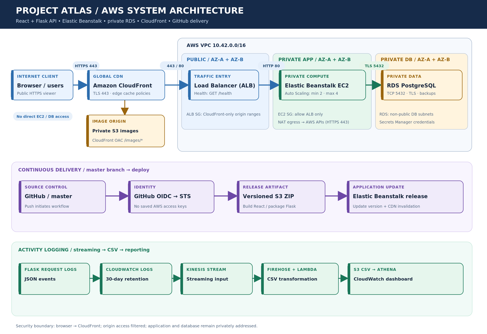

# Project Atlas
**React + Python on AWS | CloudFormation reference implementation**  
Architecture baseline: 17 November 2026 | Region example: `ap-south-1` (Mumbai)

Project Atlas is a compact, resilient reference system for a startup that needs a public web frontend, private data, predictable scaling and an audit trail. The infrastructure is designed for real AWS services, but **the stack has not been deployed into an AWS account from this workspace**. No live console screenshots, bucket URLs, DNS names or measured recovery times are claimed.



## 1. What is in this repository?

| Directory | Purpose |
|---|---|
| `infra/main.yaml` | CloudFormation for networking, RDS, Elastic Beanstalk, CDN, IAM, CloudWatch, Kinesis and Firehose |
| `backend/` | Python Flask API and React static-file server, production Gunicorn Procfile |
| `frontend/` | Custom React/Vite UI using same-origin API and `/images/` S3 assets |
| `.github/workflows/deploy.yml` | Push-to-`master` build, AWS OIDC, immutable S3 releases and EB update |
| `diagrams/` | High-resolution PNGs, editable SVGs, Python diagram renderer and alternative DOT drafts |
| `analytics/athena.sql` | External CSV schema and example hourly query |
| `scripts/` | One-time OIDC, stack deployment, image upload, verification, CSV download, offline checks |
| `docs/` | Runbook, security and failure-mode decisions, screenshot/evidence checklist |
| `assets/ui/atlas-banner.png` | Example PNG image intended for private S3 bucket |

### Updated visual diagrams (PNG + editable SVG)

- [System overview](diagrams/architecture.png) · [SVG](diagrams/architecture.svg)
- [Network and security blueprint](diagrams/network.png) · [SVG](diagrams/network.svg)
- [Activity logs / CSV analytics](diagrams/telemetry.png) · [SVG](diagrams/telemetry.svg)

The new diagrams are generated from `diagrams/render_blueprints.py`; older `.dot` files are retained as optional conceptual layouts and do not reproduce the updated PNG/SVG images exactly. A Windows-oriented GitHub setup guide is included at `docs/GITHUB_SETUP_WINDOWS.md`.

## 2. Requirements traced to implementation

| Project requirement | Where it is met | Evidence after deployment |
|---|---|---|
| Isolated network; database not internet-facing | Six VPC subnets, DB route table without default route; app/DB security groups | VPC subnet routes; RDS PubliclyAccessible=false |
| React on Elastic Beanstalk and automatic `master` deployment | React static build packaged with Flask Python platform; GitHub Actions on `master` | EB Environment, GitHub successful Actions job |
| Images served securely | S3 Public Access Block + CloudFront OAC signed `/images/*` requests | S3 bucket policy, CloudFront origins, PNG 200 response |
| Web and DB backups / recovery | Immutable Git/S3 EB source bundle, versioned artifact bucket, CloudFormation rebuild, RDS snapshots / PITR | S3 versions, RDS backups/snapshots, restoration exercise |
| Between two and four web instances | EB `MinSize=2`, `MaxSize=4` in two private AZs | Auto Scaling group, EC2 fleet, scaling policy |
| Unhealthy instance traffic rerouting | ALB health path `/health`, Beanstalk managed replacement | Target group health / simulated failure test |
| Activity logs as CSV, streaming and analysis/dashboard | CloudWatch Logs → Kinesis → Firehose/Lambda → private S3 CSV; Athena SQL and CloudWatch dashboard | Log events, Kinesis stream, CSV object, Athena results, dashboard |
| Global caching | CloudFront behaviors: images and hashed static assets cached; HTML/API not cached | CloudFront behaviors, response headers |

### Architecture choice

The assignment requires React on Elastic Beanstalk and a Python API, but does not require separate Elastic Beanstalk environments for each. A single Python EB deployment serves the compiled React static bundle and the API, allowing one 2–4 instance scaling policy. This reduces duplicate load balancers and avoids exposing an additional public API origin. It is an intentional startup optimization, not a general prescription for all workloads.

## 3. Network topology and connection matrix

| Component | Subnet/CIDR | Inbound | Outbound / purpose |
|---|---|---|---|
| Internet-facing ALB | Public A `10.42.0.0/24`; Public B `10.42.1.0/24` | TCP 443 **production** or 80 **demo**, only from regional CloudFront origin-facing managed prefix list | TCP 80 → application SG |
| Elastic Beanstalk EC2 | App A `10.42.10.0/24`; App B `10.42.11.0/24` | TCP 80 only from ALB SG | TCP 5432 → DB SG, HTTPS 443 to AWS APIs via NAT |
| RDS PostgreSQL | DB A `10.42.20.0/24`; DB B `10.42.21.0/24` | TCP 5432 only from app SG | No default route; remains non-public |
| CloudFront → image S3 | AWS global edge → S3 regional endpoint | SigV4 OAC signed `GET /images/*` | S3 object `images/atlas-banner.png` |
| GitHub Actions → AWS | GitHub-hosted runner → AWS APIs | STS `AssumeRoleWithWebIdentity` from `master` branch only | Upload release zip to S3 → EB release, invalidate CDN |
| EC2 → CloudWatch Logs | HTTPS 443 via NAT to regional logs API | Instance-profile role | JSON request events only (does not log request bodies, tokens, or source IP) |
| CloudWatch → Kinesis → Firehose | AWS managed APIs | IAM execution/service roles | gzip event batches → Lambda CSV transform → S3 objects |

**Ingress rule:** users only reach CloudFront. The load balancer accepts origin traffic from the CloudFront managed prefix list (weight 55 against the security group quota). The private EC2 servers and RDS are not assigned public IPs.

**Application routing:**

- `https://<distribution>.cloudfront.net/` → CloudFront default origin → Beanstalk ALB → healthy instance → React `index.html` (no-store).
- `/assets/*` → same ALB origin, long-lived cache for hashed build assets.
- `/api/status` and `/api/catalog` → same ALB origin; bypass CloudFront caching; Flask queries RDS using TLS.
- `/images/atlas-banner.png` → separate private S3 origin; CloudFront OAC signs origin requests; S3 access through an ordinary public bucket URL returns Access Denied.

**Note on HTTPS:** In the no-domain demonstration setup, browser → CloudFront is HTTPS, while CloudFront → ALB is HTTP because the AWS-generated load balancer hostname cannot be covered by a certificate you own. **This demo mode is not the production security target.** Production requires a public origin DNS record and a regional ACM certificate; then the template enables HTTPS/443 to the origin. Between ALB and the EB Nginx proxy traffic is HTTP within the VPC; teams subject to strict end-to-end encryption policies should additionally deploy HTTPS targets or service-mesh/mTLS, and validate against their controls.

## 4. Cost profile and operating modes

**Demo:** one NAT gateway, two EC2 instances continuously, the smallest appropriate RDS class, 7-day automated backups, single-shard Kinesis and buffered Firehose delivery. Costs accrue continuously even at zero traffic. NAT data processing, multi-AZ RDS, EC2, CloudFront egress and observability can be the dominant charges; AWS Free Tier should not be assumed.

**Production:** two NAT gateways (`DUAL_NAT=true`) for independent per-zone egress, multi-AZ RDS, DB deletion protection, validated ACM certificates for the origin and site, Route53 records, monitored backup restoration, least-privilege IAM review, WAF attachment, budget alarms and security audit logging. WAF and organization-wide CloudTrail/GuardDuty are **recommended extensions**, not falsely represented as being in this stack. The CloudFront cache policy is designed for a general small application; edge protection and capacity controls should be revisited at larger volumes.

## 5. Prerequisites

1. AWS account with permissions for CloudFormation, IAM, VPC, EC2, RDS, S3, CloudFront, Elastic Beanstalk, Lambda, Kinesis, Firehose, CloudWatch and (optionally) ACM/Route53. Check service quotas, because these are **billable AWS resources**.
2. AWS CLI v2 (`aws --version`), configured with a user or federation profile allowed to deploy infrastructure. Never commit credentials.
3. Git and GitHub repository holding this project. Use the `master` branch to satisfy the assignment. GitHub Actions environments and repository variables must be enabled.
4. Node.js 22 and npm for local builds; Python 3.13 for local backend checks; `svgwrite` and `CairoSVG` only when regenerating the new SVG/PNG blueprints.
5. For production: own a domain, verify an **origin certificate in the deployment Region** and a **viewer certificate in `us-east-1`**, and provide a public Route53 hosted zone (or manage equivalent DNS manually).

## 6. Deployment: numbered steps

**Step 1 - Create the repository.** Extract this bundle into a new folder. From that folder:

```bash
git init -b master
git add .
git commit -m "Initial Atlas architecture and application"
git remote add origin https://github.com/<OWNER>/<REPO>.git
# You may push now: builds/tests run, and AWS deployment is skipped until six variables are set.
```

**Step 2 - Select a Region and verify credentials.** Run from the project root in Bash (Linux, macOS, Git Bash or WSL):

```bash
aws sts get-caller-identity
export REGION=ap-south-1
export REPOSITORY_FULL_NAME=<OWNER>/<REPO>
```

**Step 3 - Bootstrap GitHub OIDC once per AWS account.** This creates or reuses the issuer `https://token.actions.githubusercontent.com`. It does not store long-lived AWS secrets in GitHub.

```bash
bash scripts/bootstrap-oidc.sh
```

**Step 4 - Deploy CloudFormation.** For a demonstration (the public origin hop is HTTP; see above):

```bash
export PROJECT_NAME=atlas
export STAGE=demo
bash scripts/deploy-stack.sh
```

The script discovers the Region-specific CloudFront prefix list and an available Python 3.13 Amazon Linux 2023 solution stack. It creates a Change Set-backed CloudFormation deployment and prints stack outputs. Use `aws cloudformation describe-stack-events --stack-name atlas-demo --region "$REGION"` to diagnose creation failures. Check if your chosen Region supports all selected DB class/engine combinations.

**Step 4b - Production domain and TLS example.** Only use validated certificates; the CloudFront certificate must be issued in `us-east-1`:

```bash
export STAGE=production
export ORIGIN_DOMAIN_NAME=origin.example.com
export ORIGIN_ACM_CERT_ARN=arn:aws:acm:ap-south-1:<ACCOUNT>:certificate/<ID>
export SITE_DOMAIN_NAME=app.example.com
export CLOUDFRONT_ACM_CERT_ARN=arn:aws:acm:us-east-1:<ACCOUNT>:certificate/<ID>
export PUBLIC_HOSTED_ZONE_ID=ZEXAMPLEZONEID
bash scripts/deploy-stack.sh
```

The production mode forces dual NAT, RDS Multi-AZ and deletion protection. To **switch an existing HTTP-only demo distribution to HTTPS origin**, first provision the ALB HTTPS listener and origin DNS/certificate, then validate connectivity and update the CDN behavior; do not assume an in-place toggle is downtime-free.

**Step 5 - Configure six GitHub Actions repository variables.** Go to **GitHub repository → Settings → Secrets and variables → Actions → Variables**. All values come from the CloudFormation output table:

| Variable | Value |
|---|---|
| `AWS_REGION` | e.g. `ap-south-1` |
| `AWS_ROLE_ARN` | `GithubDeployRoleArn` |
| `EB_APP` | `ElasticBeanstalkApplication` |
| `EB_ENV` | `ElasticBeanstalkEnvironment` |
| `ARTIFACT_BUCKET` | `ArtifactBucketName` |
| `CDN_DISTRIBUTION_ID` | `CDNDistributionId` |

Apply repository branch protection and require reviewed pull requests before merges to `master`. The workflow intentionally does **not** declare a GitHub Actions environment, because environment-scoped OIDC tokens have a different `sub` claim and would not match this branch-scoped AWS trust policy. No AWS access key ID or secret access key is required.

**Step 6 - Generate the npm lock file locally.** Internet access to npm is needed, unavailable in the environment in which this project was authored. From the project root:

```bash
cd frontend
npm install
npm run build
cd ..
git add frontend/package-lock.json
```

**Step 7 - Commit and push the `master` branch.** If you already pushed your initial commit before AWS setup, this second push will deploy when the six variables are present; alternatively run the workflow manually from Actions.

```bash
git add .
git commit -m "Add reproducible frontend dependency lock and deployment"
git push -u origin master
```

GitHub Actions checks out the commit, tests source syntax, builds React, downloads the official AWS RDS CA bundle, packages the Flask/React distribution, assumes the scoped OIDC role, uploads a versioned S3 zip, and updates Elastic Beanstalk. After the environment reports a green state, it invalidates `/` and `/index.html` in CloudFront. Check **GitHub → Actions → Build, test and deploy Atlas**. If GitHub asks to approve the production environment, approve it.

**Step 8 - Upload sample PNG to private storage.** Use `scripts/upload-images.sh` to upload `assets/ui/atlas-banner.png`. The bucket is private. The script prints `s3://<actual-bucket>/images/atlas-banner.png` and the corresponding CloudFront URL. **These are printed only after deployment**; no live S3 link can be produced before creating the account resources.

```bash
export STACK_NAME=atlas-demo
bash scripts/upload-images.sh
bash scripts/verify-deployment.sh
```

A successful result shows `GET /health` status 200, `/api/status` with a reachable DB, a CloudFront-served PNG 200 response, and green EB health.

**Step 9 - Generate request traffic and inspect analytics.** Browse the site and call `/api/catalog`. Wait at least the configured Firehose buffer interval plus normal delivery time before checking. In S3, inspect the `activity/` prefix under `AnalyticsBucketName`. Download CSV using:

```bash
bash scripts/download-csv.sh
```

The CSV files have **no header row**; columns are documented in `analytics/athena.sql`. Open Athena, set an S3 query-results location, substitute the real analytics bucket name in that SQL, create the table, and run the hourly query. The stack-created CloudWatch dashboard provides request counts, 5xx errors, latency and recent events. This application activity pipeline is not a replacement for a full CloudTrail/ALB/security logging strategy.

**Step 10 - Capture genuine LMS screenshots.** Follow `docs/evidence-checklist.md`. Capture your **actual** deployed VPC, instance count, S3 policies, logs, CSV file, CDN, RDS backup details and CloudFormation resource status. No screenshots have been fabricated.

## 7. Validation and recovery

The included `python scripts/static-check.py` validates YAML structure, internal CloudFormation references, 2–4 fleet settings, Python syntax, and a representative gzip-to-CSV Lambda transformation. It does **not** call AWS and does **not** prove live service deployment.

For AZ instance failure, ALB health checks and Auto Scaling replace failed app nodes. For compromised/corrupted web changes, revert to a prior immutable Beanstalk application version backed by versioned S3, or rebuild from the CloudFormation template. RDS uses snapshots, 7-day automated backups and Multi-AZ when enabled; restoring a database snapshot creates a **new DB endpoint**. Update stack wiring only through controlled recovery procedures and rehearse cutover. See `docs/recovery-runbook.md` for concrete operations.

## 8. What's deliberately not done here

- No live AWS deployment, console screenshots or S3 URLs are invented. Infrastructure templates are not a substitute for CloudFormation stack creation.
- RDS certificate verification is implemented via a CA bundle downloaded from the AWS trust store during deployment; validate that bundle's freshness in each release.
- The default demo **does not** encrypt CloudFront → ALB traffic. Production parameters enable HTTPS to the ALB; ALB → EC2 remains HTTP within VPC and may require strengthening for regulated workloads.
- Separate app and API fleets, Cognito authentication, AWS WAF, end-to-end mTLS, dedicated migration jobs, organization-wide audit logging, cross-Region disaster recovery and cost dashboards would be sensible next-stage enhancements, not hidden assumptions.
- Full IAM policy simulation, cloudformation validate-template, deployed smoke/integration tests and a real restore exercise must happen in your AWS account; source-only tests are not proof of production readiness.

## 9. Official references

- Elastic Beanstalk VPC and Auto Scaling options: https://docs.aws.amazon.com/elasticbeanstalk/latest/dg/command-options-general.html
- Supported Beanstalk platforms: https://docs.aws.amazon.com/elasticbeanstalk/latest/platforms/platforms-supported.html
- Beanstalk Procfile: https://docs.aws.amazon.com/elasticbeanstalk/latest/dg/python-configuration-procfile.html
- S3 CloudFront Origin Access Control: https://docs.aws.amazon.com/AmazonCloudFront/latest/DeveloperGuide/private-content-restricting-access-to-s3.html
- CloudFront managed prefix list: https://docs.aws.amazon.com/vpc/latest/userguide/working-with-aws-managed-prefix-lists.html
- CloudWatch Logs streaming: https://docs.aws.amazon.com/AmazonCloudWatch/latest/logs/SubscriptionFilters.html
- Firehose CloudFormation: https://docs.aws.amazon.com/AWSCloudFormation/latest/TemplateReference/aws-resource-kinesisfirehose-deliverystream.html
